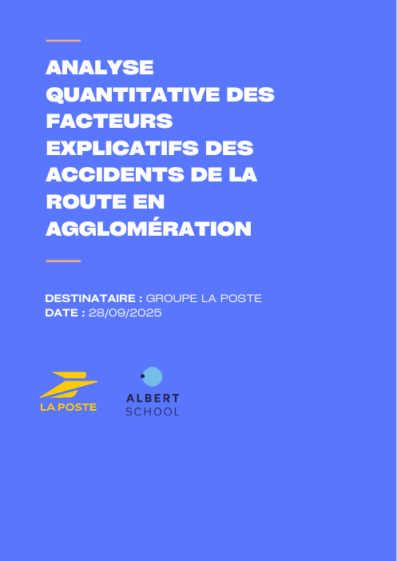
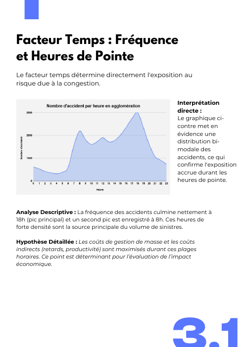
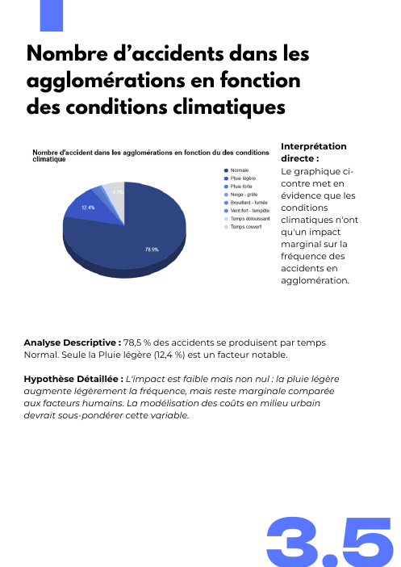
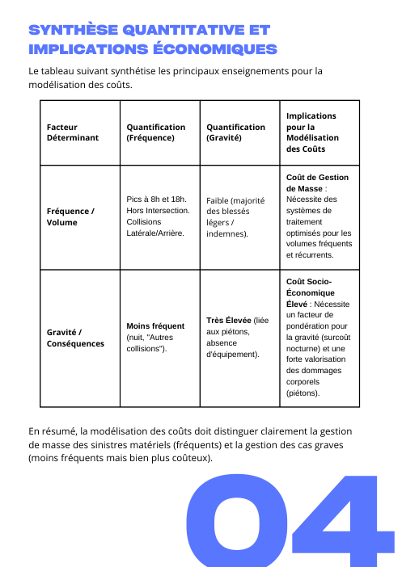
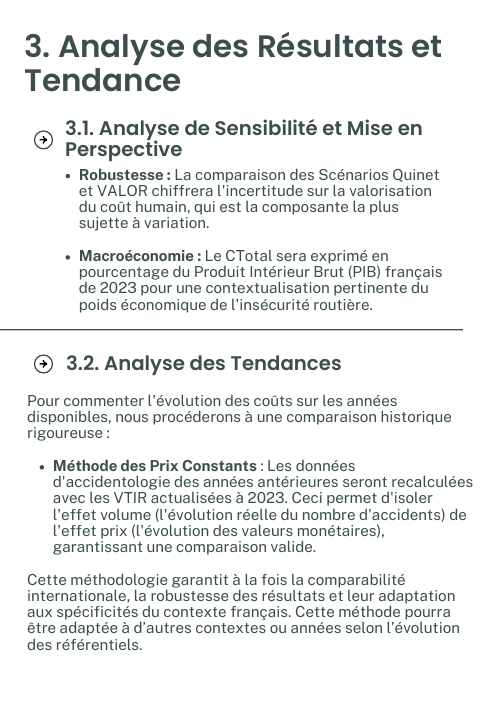

# 🚦 La Poste Assurances — Road-accident risk & socio-economic cost

> What drives urban road accidents in France, and **how much do they cost the economy**? A data-driven deep dive to inform La Poste Assurances' car-insurance pricing and claims handling.

**Albert School × Groupe La Poste business case · September–October 2025 · team of 4**

> This project was delivered as analysis reports and a business deck (no code repository). Below: method, key results and previews of our deliverables. Source data: public French road-accident files (ONISR / data.gouv.fr, 2023).

---

## 1 · Quantitative analysis of accident drivers (urban areas)
Descriptive statistics on **70,861 urban accidents (2023)** across four factor families:

| Factor | Finding | Insurance implication |
|---|---|---|
| **Time** | Bimodal distribution — peaks at **8 am and 6 pm** (rush hours) | Mass-claims handling must scale at peak hours |
| **Place** | Most accidents happen **outside intersections** (~17,000 cases), 46 % on municipal roads | Prevention should target behaviour on straight road sections |
| **Collision type** | Side / rear-end collisions dominate (42 % "no change of direction" manoeuvres) | Frequent, low-severity claims → fast-track processes |
| **Severity modulators** | Night, lighting and weather sharply increase severity (pedestrians, no equipment) | Weight pricing by a **night-severity** and **pedestrian-risk** factor |

  

## 2 · Socio-economic cost methodology
Based on the official French **VTIR** values (*Valeurs Tutélaires de l'Insécurité Routière*): direct costs (care, damage, emergency services) + indirect costs (lost productivity) + human costs (value of a statistical life / serious injury, willingness-to-pay method), adjusted with night-severity (λ) and urban-frequency (μ) coefficients.

| Unit cost per victim (2023) | Reference scenario | High scenario |
|---|---|---|
| Death | ~3.6 M€ | ~5.7 M€ |
| Serious injury | ~447 k€ | ~891 k€ |
| Slight injury | ~18 k€ | ~29 k€ |
| Material-only accident | ~5.4 k€ | ~5.5 k€ |

**Estimated total cost of road insecurity: 46 – 67 bn€ (≈ 1.6 – 2.3 % of 2023 GDP).**

## 3 · Recommendations for La Poste Assurances
- Integrate **night severity** and **pedestrian risk** into pricing.
- Build fast claims journeys for frequent low-severity collisions.
- Prevention campaigns focused on rush-hour behaviour.
- Align insurance strategy with the real economic weight of accidents.

## Tools
`Python` `pandas` `descriptive statistics` `ONISR open data` `VTIR cost framework` `Canva` `PowerPoint`

---

### 🇫🇷 En bref
Cas La Poste (sept.–oct. 2025) : analyse descriptive de 70 861 accidents urbains de 2023 (heures de pointe, lieux, types de collision, lumière et météo), puis méthodologie de coût socio-économique fondée sur les VTIR — 46 à 67 Md€, soit 1,6 à 2,3 % du PIB. Recommandations de tarification et de gestion des sinistres pour La Poste Assurances.
